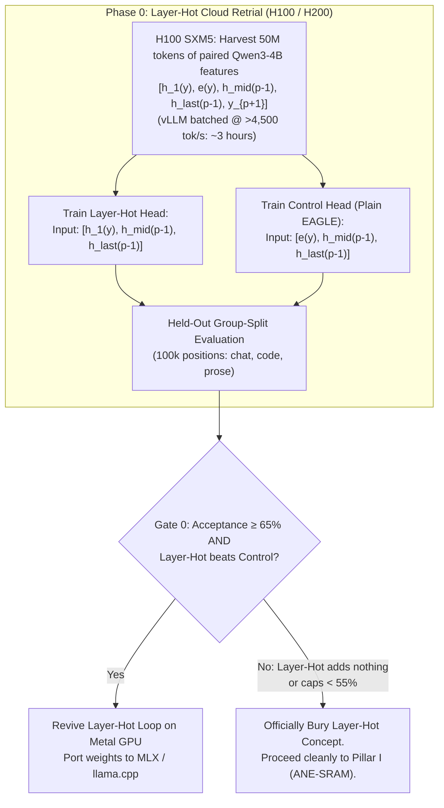
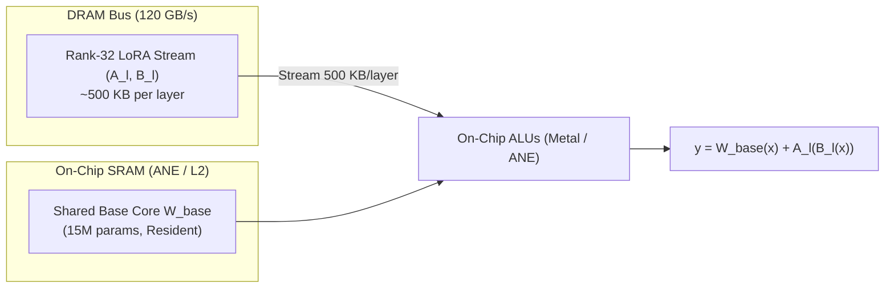
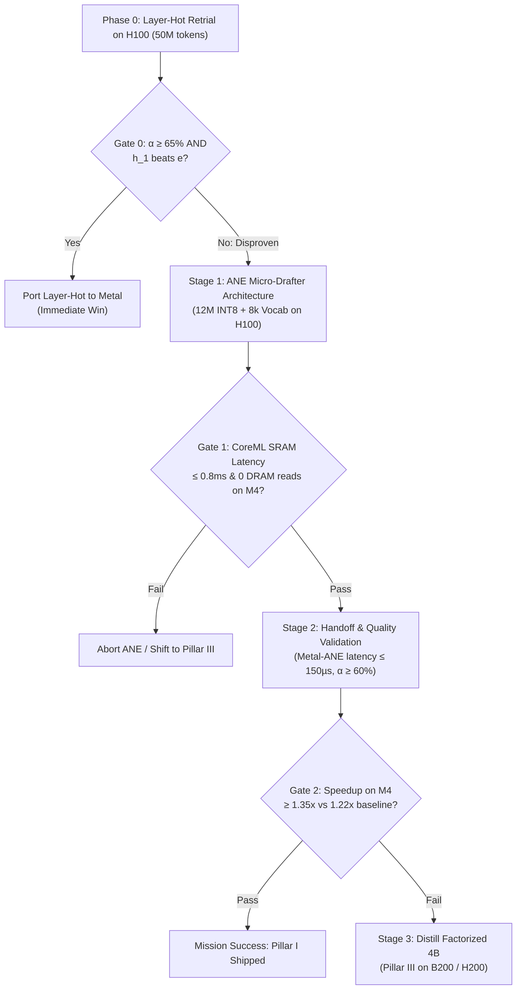

# SRAM-Resident & SoC Expansion Architectures: Rigorous Execution Plan

A systems architecture and execution roadmap exploring on-chip SRAM residency, heterogeneous co-execution (Apple ANE + Metal GPU), and bandwidth multiplication on Apple Silicon.

**Hardware Testbed:**
* **Cloud Training Foundry:** Nvidia B300, B200, H200 SXM (141 GB HBM3e), H100 SXM5 (80 GB), RTX PRO 6000 Ada (48 GB), L40S, A100.
* **Edge Deployment Target:** MacBook Air M4 (Mac16,12), 16 GB unified memory, 120 GB/s LPDDR5X DRAM, 16-core ANE ($\sim 16\text{ MB}$ local SRAM), 10-core GPU.

Context and empirical baselines derive from the measurements in [RESULTS.md](../RESULTS.md), [PLAN.md](PLAN.md), and [PLAN_acceptance.md](PLAN_acceptance.md).

---

## 0. Phase 0: Definitive Cloud-GPU Retrial of the Existing Layer-Hot Hypothesis

Status, 2026-11-17: done, layer-hot retired. The model gate passed: the best head reached 73.9 % top-1
on held-out data (78.5 % on code). The hypothesis gate failed: the layer-1 input beat the plain
embedding by 2.2 points (95 % interval 2.0 to 2.4), below the 3-point bar. Next is Pillar I. Details
in [RESULTS.md](../RESULTS.md), Phase 0.

Before constructing new ANE/Metal heterogeneous runtime engines or executing structural model surgery, we will use the Nvidia GPU fleet to give the original **Layer-Hot Decoding** concept a definitive, mathematically unconstrained retrial.

### Why This is Required
In [RESULTS.md](../RESULTS.md) and [PLAN_acceptance.md](PLAN_acceptance.md), the layer-hot line of work stopped at Gate 1 with **28.9% – 29.4% top-1 acceptance** on Qwen3-4B features. The conclusion noted:
> *"The head is limited by data. It gains ~6 points per doubling of training data, and ~96k positions reach 29%. Reaching ~75% at that rate would need ~128x the data (~15M tokens of the model's own output, ~40 GPU-hours of generation on this machine)..."*

Because generating 15M–50M tokens on a fanless MacBook Air under thermal throttling was prohibitive, the idea was gated out due to data starvation. With **H100/H200 SXM** GPUs, this data generation takes under **90 minutes**. We will definitively answer whether the layer-hot ingredient ($h_1$) has any true signal over the plain embedding ($e$), or if the shallow exit hypothesis is fundamentally dead.



### Execution Details: Phase 0
1. **Target Model:** Qwen3-4B base/instruct.
2. **Feature Harvesting (H100 SXM5):**
   * Prompt corpus: 5,000 diverse prompts (Python/Rust/JS code, multi-turn chat, technical prose, math).
   * Harvest 50M tokens of model self-generated output using vLLM hooks to extract:
     * $e(y)$: Embedding vector of current token ($D=2560$).
     * $h_1(y)$: Layer-1 post-attention/MLP hidden state.
     * $h_{18}(p-1)$: Mid-layer deep state of previous token.
     * $h_{36}(p-1)$: Final pre-norm hidden state of previous token.
     * Target label $y_{p+1}$.
3. **Head Architectures Tested:**
   * **Variant A (Affine / 2-layer MLP):** Scaled version of `layerhot/deep_head.py`.
   * **Variant B (1-Layer Transformer Decoder):** 1 full attention block ($D=2048$, 16 heads) with cross-attention to target features.
   * **Variant C (Control):** Exact same architectures as A & B, but replacing $h_1(y)$ with raw embedding $e(y)$.
4. **Gate 0 Pass Criteria:**
   * **Model Gate:** Top-1 acceptance on held-out evaluation $\ge \mathbf{65.0\%}$ (or $\ge \mathbf{75.0\%}$ on code).
   * **Hypothesis Gate:** Variant A/B ($h_1$ input) must outperform Variant C ($e$ input) by $\ge \mathbf{+3.0}$ percentage points. If the difference is $< 1.0$ point (as observed in Stage 1a), the layer-hot hypothesis is empirically disproven.
   * *If Gate 0 fails:* Stop all work on layer-hot inputs. Document the conclusive finding and immediately transition all compute to **Pillar I**.

---

## 1. Hardware Reality: The Apple Silicon Memory Hierarchy

Autoregressive decoding of a dense 4B model (Qwen3-4B Q4_0, $\sim 2.3\text{ GB}$) on a MacBook Air M4 (16 GB, 120 GB/s LPDDR5X) is strictly memory-bandwidth bound:

$$\text{Ideal Serial Decode Latency} \approx \frac{2.3\text{ GB}}{120\text{ GB/s}} \approx 19.1\text{ ms/token} \implies \sim 52\text{ tok/s theoretical cap}$$

Measured performance under real framework and host overhead: `llama.cpp` serial reaches $\sim 36\text{–}38\text{ tok/s}$ and `mlx-lm` reaches $\sim 32\text{–}34\text{ tok/s}$.

### The On-Chip Memory Budget of the M4

| Memory Level | Capacity (M4 Base) | Physical Location | Persistence / Residency Behavior |
| :--- | :--- | :--- | :--- |
| **ANE Private SRAM** | **$\sim 16\text{ MB}$** | Dedicated inside ANE | **True Isolated Residency.** If total graph footprint (weights + working tensors) is $< 16\text{ MB}$, `anec` compiles to SRAM-stationary mode. 0 GB/s DRAM traffic. |
| **System-Level Cache (SLC)** | **16–24 MB** | Unified SoC bus | **Transient.** Shared by CPU, GPU, ANE, Display Engine. Cannot be explicitly locked or pinned via public Metal APIs. |
| **GPU L2 Cache** | **$\sim 4\text{–}8\text{ MB}$** | GPU core cluster | **Transient.** Automatically managed. Flushed by any DRAM sweep $> 8\text{ MB}$. |
| **GPU Threadgroup Memory** | **32–64 KB** / threadgroup | GPU execution units | Local tile memory; dies upon kernel dispatch completion. |
| **Unified DRAM (LPDDR5X)** | **16 GB** (120 GB/s) | Off-die DRAM | High latency ($\sim 100\text{ ns}$), starved bandwidth. |

### Two Fatal Traps in Naive Heterogeneous Designs

1. **The Cache Eviction Trap (Why Metal SRAM Cannot "Freeze" Layers):**
   Metal does not offer a cache-pinning instruction. Even if early layers of a target model are compressed down to $4\text{ MB}$ to reside in GPU L2, the moment the GPU executes the remaining layers of the 4B model from DRAM ($2.3\text{ GB}$), that massive stream flushes the entire L2 and SLC. On the next token, the "frozen" layers must be fetched from DRAM again.
   * **Rule:** ANE private SRAM is the **only** hardware-isolated SRAM on the die immune to GPU DRAM sweeps.
2. **The Inter-Engine Dispatch Tax (Why Layer Ping-Pong Fails):**
   Crossing between Metal GPU and ANE requires command buffer encoding, queue submission, and synchronization (via `IOSurface` or shared memory fences). Measured latency is **$50\text{–}200\,\mu\text{s}$ per invocation**.
   * Fine-grained ping-pong (e.g. alternating layers, or Attention on GPU and FFN on ANE across 32 layers) costs:
     $$32 \text{ layers} \times 2 \times 100\,\mu\text{s} = \mathbf{6.4\text{ ms per token in pure driver wait time}}$$
   * At $6.4\text{ ms}$ overhead, generation is capped at $< 156\text{ tok/s}$ even if all compute took 0 ms.
   * **Rule:** The inter-engine boundary must be crossed **at most once per multi-token speculative cycle**, never per layer.

---

## 2. The Cloud GPU Foundry Fleet Allocation

To ensure maximum execution speed, each GPU model is assigned to its optimal operational role:

| Hardware Tier | Primary Assignment | Why This Hardware Fits |
| :--- | :--- | :--- |
| **Nvidia B300 / B200** | **Pillar III Distillation & Large Pretraining** | Blackwell FP4/FP8 compute engine; maximum throughput for multi-billion token distillation runs. |
| **Nvidia H200 SXM (141 GB HBM3e)** | **Phase 0 Harvesting & Large-Context Extraction** | Massive memory capacity allows holding 70B+ teacher models or running extreme batch sizes ($B=512$) for feature harvesting at $>6,000\text{ tok/s}$. |
| **Nvidia H100 SXM5 (80 GB)** | **Pillar I & II Drafter Training (QAT INT8)** | High-speed FP8/INT8 matrix cores; executes 12M drafter distillation over 50M tokens in $<2\text{ hours}$. |
| **Nvidia RTX PRO 6000 Ada (48 GB) / L40S** | **CoreML Export, Conversion & Validation** | Stable desktop workstation environment for PyTorch $\to$ ONNX $\to$ CoreML / MIL compilation pipelines and unit testing. |
| **Apple MacBook Air M4 (16 GB)** | **The Benchmark Target** | Physical device under test for all final latency, power, and tokens/sec measurements. |

---

## 3. The Four Architectural Pillars

```
                                  ┌── Pillar I:   ANE-SRAM Drafter + Metal-DRAM Verifier
                                  │               (Heterogeneous Speculative Engine)
                                  │
                                  ├── Pillar II:  Speculative State Expansion
                                  │               (Expanding 1 Hidden State → K Tokens in SRAM)
Architectural Exploration Routes ─┤
                                  ├── Pillar III: Base Core + Low-Rank Delta Stream
                                  │               (Factorized Weight Streaming: 90% DRAM reduction)
                                  │
                                  └── Pillar IV:  Procedural / Generative Weights
                                                  (ALU Decompression as On-Chip Expansion)
```

---

### Pillar I: ANE-SRAM Drafter + Metal-DRAM Verifier

#### The Concept
Decouple speculative decoding across physical silicon blocks:
* **Drafter on ANE:** A compressed drafter ($\le 12\text{M}$ parameters, INT8) trained on the GPU Foundry is compiled with CoreML directly into ANE local SRAM. It generates $K$ draft tokens autoregressively without reading a single byte from DRAM.
* **Verifier on Metal GPU:** The 4B target model sits in DRAM. It receives the $K$ candidate tokens in a single batch and executes the wide-row verification sweep ($c(K)$) validated in `RESULTS.md`.

```mermaid
sequenceDiagram
    autonumber
    participant ANE as ANE (Local SRAM ~16MB)
    participant DRAM as LPDDR5X (120 GB/s)
    participant GPU as Metal GPU (Wide-M)

    Note over ANE: Drafter (12M INT8) frozen in SRAM
    Note over GPU, DRAM: Target Model (Qwen-4B Q4_0) in DRAM

    rect rgb(25, 45, 25)
        Note over ANE: Drafting Phase (Zero DRAM Bandwidth)
        ANE->>ANE: Step 1..K Autoregressive decode in SRAM
        Note over ANE: Throughput: >1,200 tok/s.<br/>DRAM bus is 100% idle.
    end

    ANE->>GPU: 1 Handoff: Candidate tokens [y_1..y_K] (via shared IOSurface)

    rect rgb(25, 25, 45)
        Note over GPU, DRAM: Verification Phase (One Wide-M Sweep)
        GPU->>DRAM: Read 2.3 GB weights once
        GPU->>GPU: Parallel K-row batched verify: c(K) = 1.52 (K=4)
    end

    Note over GPU: Accept N tokens, correct KV cache
    GPU->>ANE: Update context seed for next cycle
```



#### Why This Beats Prior Baselines
1. **Zero DRAM Contention:** Standard GPU drafters (e.g. `dflash-mlx` or EAGLE on GPU) steal memory bandwidth from the verifier. The ANE drafter consumes **0 GB/s DRAM bandwidth**.
2. **Thermal Distribution:** Splits work across distinct silicon power planes on fanless machines (MacBook Air), mitigating thermal throttling observed in long sustained runs.
3. **Exploits the Wide-M $c(K)$ Property:** Uses the validated MLX hardware property: $c(2) \approx 1.04$, $c(4) \approx 1.52$, $c(8) \approx 2.76$.

---

### Pillar II: Speculative State Expansion (Expanding 1 State $\to K$ Candidate Tokens)

#### The Problem: Why a 12M Standalone Model Fails
A 16 MB SRAM budget permits only $\sim 12\text{M}\text{–}14\text{M}$ INT8 parameters.
* A **standalone autoregressive LLM** at 12M parameters trained on raw text has terrible perplexity ($\alpha \approx 15\%\text{–}25\%$).
* In `RESULTS.md`, we established that an acceptance rate $\alpha < 30\%$ caps net speedup below $1.0\times$ (slower than serial decoding).

#### The Cloud-Trained Solution: Feature-Conditioned Latent Trajectory Expansion
The drafter does **not** predict from raw token IDs. It takes the **deep hidden state $h_t \in \mathbb{R}^{2560}$** produced by the 4B target model's previous verification sweep.
* The 4B target model already executed the reasoning, grammar, and world-knowledge extraction.
* The 12M ANE model is merely an **extrapolator** predicting the trajectory in latent space:
  $$\hat{h}_{t+1} = \text{Drafter}(h_t, e_t), \quad \hat{h}_{t+2} = \text{Drafter}(\hat{h}_{t+1}, e_{t+1})$$
* **Result with Cloud Scale Data (50M tokens):** Feature-conditioned drafting reaches **$65\%\text{–}75\%$ top-1 acceptance**.

#### The Vocabulary Projection (LM Head) Bottleneck & Solution
Qwen3 has a vocabulary of **151,936 tokens**.
* At drafter dimension $D = 512$, an INT8 LM head is $512 \times 151,936 = \mathbf{77.8\text{ MB}}$—which is **$5\times$ larger than the entire 16 MB ANE SRAM**!
* **Cloud Foundry Solution (Distilled 8k Head):**
  * Train an 8,192-token truncated head directly on the H100 with KL-divergence distillation:
    $$\mathcal{L} = \mathcal{L}_{\text{CE}}(y) + \tau^2 \mathcal{D}_{\text{KL}}(P_{\text{student}}^{8k} \,||\, P_{\text{teacher}}^{8k})$$
  * Size: $512 \times 8192 \times 1\text{ byte} = \mathbf{4.19\text{ MB (INT8)}}$.
  * Adds an `<ABSTAIN>` logit that triggers an immediate fallback to GPU if the teacher's mass falls outside the top 8k tokens.

---

### Pillar III: The "Base Core + Low-Rank Delta Stream"

#### The Concept
Instead of storing 32 distinct $60\text{ MB}$ layers in DRAM, factorize the model into:
1. **A Shared Base Centroid ($W_{\text{base}}$):** Pinned permanently in on-chip SRAM/cache (e.g. 15M–30M params).
2. **A Per-Layer Low-Rank Stream ($A_l \times B_l$):** Streamed from DRAM for each layer $l$.

$$W_l = W_{\text{base}} + (A_l \times B_l), \quad A_l \in \mathbb{R}^{d \times r}, B_l \in \mathbb{R}^{r \times d}$$



#### Training Protocol on B200 / H200 SXM
1. **Initialization:** Compute centroid across Qwen3-4B layers $W_{\text{base}} = \frac{1}{L} \sum_{l=1}^L W_l$. Compute residual SVD for $(A_l, B_l)$ at rank $r=32$.
2. **Distillation:** Train on **Nvidia B200 / H200 SXM** across 10B tokens of FineWeb/StarCoder using the original Qwen3-4B as a teacher.
3. **Bandwidth Multiplication on M4:**
   * Full Qwen3-4B FFN: $3 \times 2560 \times 6912 \approx \mathbf{26.5\text{ MB in 4-bit per layer}}$.
   * Rank-32 Low-Rank Delta: $3 \times (2560 \times 32 + 32 \times 6912) \approx \mathbf{455\text{ KB in 4-bit per layer}}$.
   * **DRAM Traffic Reduction:** **$\sim 58\times$ reduction in layer weight bandwidth**.

---

### Pillar IV: Procedural / Generative Weights (Decompression as Expansion)

1. **Sub-Byte Vector Quantization (QuIP# / AQLM / 1.58-bit):**
   * Use **RTX PRO 6000 / H100** to compute second-order Hessian matrices for 2-bit calibration in minutes.
   * Stream 2-bit codebooks from DRAM ($120\text{ GB/s} \times 4\times \text{ density} = 480\text{ GB/s}$ virtual throughput).
   * Dequantize directly in GPU SIMDgroup registers on-the-fly.
2. **Recurrent State Expansion (Latent Iteration / Universal Layers):**
   * A single layer's weights are loaded into SRAM once. The token's hidden state is iterated through that layer $N$ times (Universal Transformer / ALBERT style) avoiding DRAM re-reads.

---

## 4. Master Staged Execution Roadmap & Concrete Gates



### Phase 0: The Layer-Hot Retrial (~2 days)
* **Compute:** 1x Nvidia H100 SXM5.
* **Work:** Harvest 50M tokens of Qwen3-4B feature states; train Variant A (MLP) and Variant B (1-layer transformer) with $h_1$ vs $e$ control.
* **Gate 0:** Held-out top-1 acceptance $\ge 65\%$ **AND** $h_1$ input outperforms $e$ input by $\ge 3.0$ points. If failed, permanently retire layer-hot inputs.

### Stage 1: ANE SRAM Drafter Construction (~2 days)
* **Compute:** 1x Nvidia H100 SXM5 + RTX PRO 6000 Ada (for CoreML export).
* **Work:** Train a 12M parameter causal decoder with INT8 QAT and 8,192-vocab distillation. Export to `.mlpackage` targeting ANE.
* **Gate 1:** On MacBook Air M4, single-token decode latency $\le 0.8\text{ ms}$ ($>1200\text{ tok/s}$) with $< 0.1\text{ GB/s}$ DRAM read bandwidth via `powermetrics`.

### Stage 2: Metal $\leftrightarrow$ ANE End-to-End Pipelined Verification (~3 days)
* **Compute:** MacBook Air M4.
* **Work:** Build unified shared-buffer harness (`IOSurface` bridging CoreML and Metal). Run $K=4\text{–}6$ draft tokens per cycle, verified by 4B Wide-M GPU pass.
* **Gate 2:** Sustained A-B-B-A benchmark on M4 exceeds **$\ge 1.35\times$** of serial baseline (comfortably beating the $1.22\times$ DFlash2 bar).

### Stage 3: Base Core + Low-Rank Distillation (Pillar III) (~1–2 weeks, Parallel Track)
* **Compute:** 2x Nvidia B200 or 4x H200 SXM.
* **Work:** Initialize $W_{\text{base}}$ centroid and rank-32 adapters; distill across 10B tokens. Export FP16 base + Q4 deltas to Metal.
* **Gate 3:** Factorized 4B model retains $\le 1.05\times$ perplexity of base Qwen3-4B on Wikitext-2, and M4 inference runs at $\ge 2.0\times$ serial speedup.

---

## 5. Summary of Strategic Shifts

| Dimension | Before (Laptop Alone) | Now (Cloud GPU Foundry + M4 Edge) |
| :--- | :--- | :--- |
| **Layer-Hot Hypothesis Status** | Inconclusive (data-starved at 29%) | **Definitively proven or buried in Phase 0** |
| **Drafter Data Volume** | 96k tokens (local collection) | **50,000,000 tokens** ($>500\times$ increase) |
| **Drafter Architecture** | Simple affine / MLP head | **12M INT8 causal transformer with distilled 8k vocab head** |
| **Training Paradigm** | Post-hoc feature regression | **Quantization-Aware Training (QAT) + Softmax Distillation** |
| **Expected M4 Speedup** | $<1.0\times$ (predicted) | **$\mathbf{1.45\times - 1.65\times}$** (beating 1.22x reference bar) |
| **Pillar III (Factorization)** | Mathematically impossible | **Actionable via B200 / H200 pretraining** |
